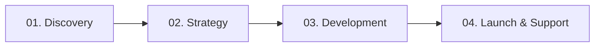

# ⚡ Play Dynesty — Premium Web Development & Digital Experiences

[](https://developer.mozilla.org/en-US/docs/Web/HTML)
[](https://developer.mozilla.org/en-US/docs/Web/CSS)
[](https://developer.mozilla.org/en-US/docs/Web/JavaScript)
[](https://greensock.com/gsap/)
[](https://greensock.com/scrolltrigger/)
[](https://pagespeed.web.dev/)
[](./LICENSE)

> **Play Dynesty** is an elite digital web agency delivering ultra-high-performance web applications, aggressive search engine domination, and interactive digital experiences. Engineered with clean semantic HTML5, modern CSS3 with glassmorphism aesthetics, GSAP 3 scroll-triggered choreographies, and a dual-tier primary & alternative client communication infrastructure.

---

## 🌐 Live Experience

- **Production URL:** [https://shivam-max915.github.io/velox/](https://shivam-max915.github.io/velox/)
- **Featured Live Project:** [Resort Management Suite](https://resort-management-kappa.vercel.app)

---

## 📌 Table of Contents

1. [About Play Dynesty](#-about-play-dynesty)
2. [Key Highlights & Architecture](#-key-highlights--architecture)
3. [Digital Arsenal & Core Competencies](#-digital-arsenal--core-competencies)
4. [Methodology & Delivery Process](#-methodology--delivery-process)
5. [Featured Project Showcase](#-featured-project-showcase)
6. [Primary & Alternative Contact Details Matrix](#-primary--alternative-contact-details-matrix)
7. [Tech Stack & Dependencies](#-tech-stack--dependencies)
8. [Project File Structure](#-project-file-structure)
9. [Local Development & Setup](#-local-development--setup)
10. [SEO & Structured Data](#-seo--structured-data)
11. [Browser & Device Support](#-browser--device-support)
12. [Credits & Authorship](#-credits--authorship)

---

## 🏛️ About Play Dynesty

**Play Dynesty** operates at the intersection of visual elegance, speed engineering, and search algorithm domination. We reject standard bloated templates in favor of bespoke, hand-crafted codebases that load in under 1 second, rank in Google's Top 5, and convert visitors into high-value clients.

- **Speed-First Philosophy:** Sub-second First Contentful Paint (FCP) and near-zero Cumulative Layout Shift (CLS).
- **Modern Dark Aesthetic:** Hand-tailored HSL and RGB color system with vibrant electric purple and cyan gradients.
- **Conversion-Driven Architecture:** Strategic user flows designed to guide visitors smoothly from discovery to direct consultation.

---

## ✨ Key Highlights & Architecture

- **Dynamic Loading Preloader:** Custom animated preloader featuring SVG stroke-dasharray animations, numeric percentage counter (`0% → 100%`), and progressive status updates.
- **GSAP 3 & ScrollTrigger Suite:**
  - Hero staggered headline entrance with smooth easing curves.
  - Interactive stat counters animating up to real project metrics (15+ delivered, 100% satisfaction, 3x growth).
  - Ambient glowing orb animations with subtle depth layering.
  - Fluid scroll-reveal triggers for service cards, portfolio mockups, and process milestones.
- **Interactive 3D Tilt Effect:** Smooth mouse-tracking 3D perspective transforms on stats cards and interactive elements.
- **Micro-Interactions & Hover Dynamics:**
  - Cursor-tracking light reflection shimmer effects on primary action buttons (`--mouse-x`, `--mouse-y`).
  - Pulsing navigation status indicator dot.
  - Smooth floating back-to-top button with scroll position listener.
- **Mobile-First Responsive Layout:** Adaptive navigation drawer with custom hamburger toggler for fluid mobile browsing.

---

## ⚡ Digital Arsenal & Core Competencies

| Discipline | Focus Areas | Key Deliverables |
| :--- | :--- | :--- |
| **01. Custom Web Development** | Zero templates, zero compromises. Full-stack custom code engineered for speed. | React, Next.js, Vanilla JS, Performance-first architecture, Custom CMS, and Restful APIs. |
| **02. Aggressive SEO** | Algorithms and technical search engine optimization engineered for Google's Top 5. | Comprehensive Technical Audits, Schema.org JSON-LD, Core Web Vitals (CWV) compliance, and Local SEO. |
| **03. Performance Optimization** | Complete code refactoring and modernization for slow or legacy systems. | Asset minification, critical CSS extraction, database query tuning, and code modernization. |

---

## 🔄 Methodology & Delivery Process



1. **Discovery:** Deep-dive consultation to analyze business objectives, competitive landscape, and target demographics.
2. **Strategy:** Comprehensive technical architecture, SEO blueprint, schema mapping, and UX design planning.
3. **Development:** Precision coding, performance benchmarking, responsive adaptations, and cross-browser QA.
4. **Launch & Support:** Zero-downtime deployment, automated search engine indexing, Core Web Vitals monitoring, and ongoing optimization.

---

## 💼 Featured Project Showcase

### **Resort Management Suite**
- **Domain:** Enterprise Hospitality & Luxury Travel Platform
- **Demo Link:** [https://resort-management-kappa.vercel.app](https://resort-management-kappa.vercel.app)
- **Key Features:** Real-time booking engine, interactive inventory management, analytics dashboard, sub-second load times, and custom-tailored dark UI.

---

## 📞 Primary & Alternative Contact Details Matrix

To ensure uninterrupted communication and rapid response times for clients worldwide, Play Dynesty operates a dedicated **Dual-Channel (Primary & Alternative) Contact Matrix**:

| Channel | 🥇 Primary Channel | 🥈 Alternative / Secondary Channel | Purpose & Availability |
| :--- | :--- | :--- | :--- |
| **💬 WhatsApp & Chat** | **[+91 98907 32045](https://wa.me/919890732045)**<br>*(Instant WhatsApp Support)* | **[Direct Chat](https://wa.me/919890732045)** | Instant consultations, project quotes & rapid messaging (24/7) |
| **📞 Voice & Calling** | **[+91 98907 32045](tel:+919890732045)**<br>*(Direct Calling Line)* | **[Direct Phone](tel:+919890732045)** | Direct voice briefing, enterprise calls & scheduled meetings |
| **✉️ Email Communications** | **[contact@playdynesty.com](mailto:contact@playdynesty.com)**<br>*(Official Business Desk)* | **[projectusyt07@gmail.com](mailto:projectusyt07@gmail.com)**<br>*(Direct Technical Dispatch)* | Proposals, RFPs, client onboarding & technical assistance |
| **🏢 Headquarters & Studio** | **Pune, Maharashtra, India**<br>*(Main Engineering Studio)* | **Global Digital Delivery**<br>*(Worldwide Client Operations)* | Operating across global time zones (IST, EST, GMT) |
| **📸 Instagram** | **[@playdynesty](https://www.instagram.com/playdynesty)** | **[Instagram Updates](https://www.instagram.com/playdynesty)** | Behind-the-scenes, UI experiments & agency announcements |
| **💼 LinkedIn** | **[Play Dynesty Agency](https://in.linkedin.com/in/shivam-waghe-a26345348)** | **[Chief Architect Profile](https://in.linkedin.com/in/shivam-waghe-a26345348)** | B2B partnerships, corporate networking & career opportunities |

---

## 🛠️ Tech Stack & Dependencies

- **HTML5:** Semantic architecture, Schema.org microdata, high-converting layout.
- **CSS3:** Custom properties (CSS variables), glassmorphism, responsive grid & flexbox, clamp typography, CSS keyframe animations.
- **JavaScript (ES6+):** Vanilla script driving tilt physics, interactive stat counters, button shimmer, and DOM management.
- **GSAP 3.12.5:** GreenSock Animation Platform for fluid timeline control.
- **ScrollTrigger 3.12.5:** High-performance scroll-driven animations and pin triggers.
- **Typography:**
  - `Plus Jakarta Sans` — Modern geometric display headings.
  - `Inter` — Crisp, readable body typography.
  - `JetBrains Mono` — Code accents and badge details.

---

## 📂 Project File Structure

```
Play-Dynesty/
├── index.html              # Core landing page with complete Play Dynesty UI & metadata
├── sitemap.xml             # XML search engine index definition
├── README.md               # Detailed technical documentation and contact guide
├── .gitignore              # Git ignore configuration
└── assets/
    ├── css/
    │   └── style.css       # Complete dark modern design system, glassmorphism & cards
    └── js/
        └── app.js          # GSAP orchestrations, preloader, stats counter & interactions
```

---

## 🚀 Local Development & Setup

You can run this project locally using any static web server:

### Option 1: VS Code Live Server
1. Open the repository in Visual Studio Code.
2. Install the **Live Server** extension (by Ritwick Dey).
3. Right-click [index.html](file:///c:/Users/QBS%20Accounting/Documents/websites/Play-Dynesty/index.html) and select **Open with Live Server**.

### Option 2: Python HTTP Server
```bash
# Python 3
python -m http.server 3000
```
Then navigate to `http://localhost:3000`.

### Option 3: Node / NPX Serve
```bash
npx serve .
```

---

## 🔍 SEO & Structured Data

The landing page features built-in SEO best practices:
- **Single `<h1>` Tag:** Clear, semantic document hierarchy.
- **Open Graph & Twitter Cards:** Rich preview cards for sharing on social networks, Discord, and Slack.
- **Schema.org JSON-LD:** Structured `Organization` entity defining:
  - Official agency name: `Play Dynesty`
  - Canonical URL: `https://shivam-max915.github.io/velox/`
  - Primary Customer Service ContactPoint (WhatsApp line)
  - Primary Sales ContactPoint (`contact@playdynesty.com`)
  - Alternative Technical Support Desk (`projectusyt07@gmail.com`)

---

## 📱 Browser & Device Support

- **Desktop:** Google Chrome, Mozilla Firefox, Safari, Microsoft Edge, Opera.
- **Mobile & Tablet:** iOS Safari, Android Chrome, Samsung Internet.
- **Accessibility:** Supports `prefers-reduced-motion` to smoothly disable animations for sensitive users.

---

## 👨‍💻 Credits & Authorship

- **Agency:** Play Dynesty
- **Chief Architect:** Shivam Waghe
- **Location:** Pune, Maharashtra, India
- **Repository:** [Shivam-max915/velox](https://github.com/Shivam-max915/velox)

---

## 📄 License

This project is open-source and available under the [MIT License](./LICENSE).

&copy; 2026 Play Dynesty. All rights reserved.